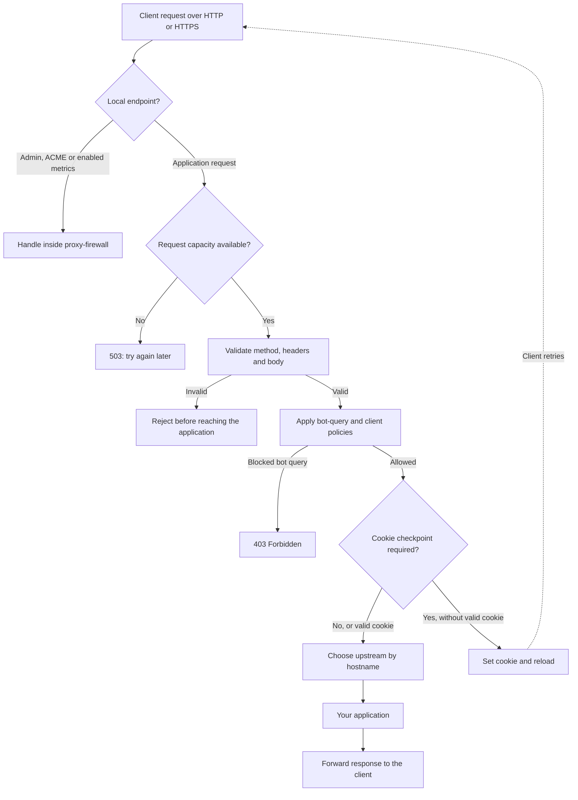
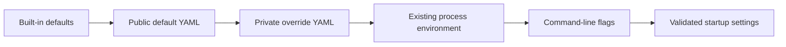
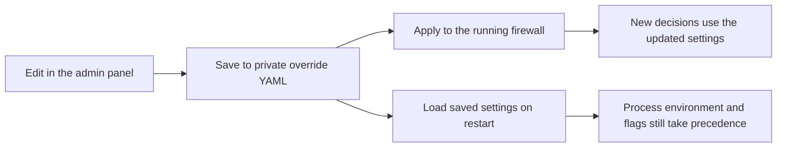

# http-proxy-firewall

Version **0.3.48** · [Changelog](CHANGELOG.md) · [MIT license](LICENSE)

A reverse proxy and Layer 7 firewall that sits in front of your web applications. It checks requests before forwarding them, adds a cookie checkpoint during traffic spikes, and provides an embedded admin dashboard.

- **Protect applications:** inspect request bodies, reject malformed forms, and control who passes the cookie checkpoint.
- **Route traffic:** send each hostname to its own HTTP or HTTPS upstream.
- **Operate from the browser:** monitor traffic, change firewall rules, and capture requests for troubleshooting.

[Quick start](#build-and-run) · [Configuration](#configuration) · [Admin panel](#admin-panel) · [Deployment](#systemd-deployment) · [Migration](#migrating-an-existing-deployment)

## How it works



Body validation runs before every application bypass, including static assets, whitelisted clients, verified Googlebot addresses and valid cookies. During a DDoS penalty, the whitelist checkpoint switches decide whether whitelisted clients also need a cookie.

Accepted requests retain their original Host, escaped path, query and inspected body. Forwarding headers use the verified client IP. Responses stream from the upstream; HTTP/1.1 connections are reused.

> These checks add defense in depth. Keep PHP workers and applications patched, and retain their own resource limits.

## Build and run

Requires **Go 1.27 or newer**. Run these commands from the repository root:

```sh
go mod download
make build
umask 077
test -e proxy-firewall.override.yaml || printf 'env: []\nrules: []\ndebug: []\n' > proxy-firewall.override.yaml
test -e .creds || cp .creds.example .creds
chmod 600 .creds proxy-firewall.override.yaml
```

Replace the example credentials in `.creds`. The public defaults enable the admin panel through that file.

For local HTTP development, start your upstream on port 8008, then run:

```sh
./bin/proxy-firewall \
  --listen=127.0.0.1:8080 \
  --proxy-to=127.0.0.1:8008 \
  --tls=false \
  --pprof-addr= \
  --ipv4-redirect=
```

Visit `http://127.0.0.1:8080` for the application and `http://127.0.0.1:8080/__pf/__admin` for the dashboard.

Redis, a MaxMind download and an ACME account are optional for this local run. Googlebot ranges refresh in the background; launch with `PF_GOOGLE_RANGES_URL= ./bin/proxy-firewall ...` to disable that download for offline use.

## Configuration

### Which file should I edit?

| File | Purpose | How it is maintained |
| --- | --- | --- |
| [`proxy-firewall.default.yaml`](proxy-firewall.default.yaml) | Public defaults supplied with the application. | Refreshed on installation or upgrade. |
| `proxy-firewall.override.yaml` | Your upstreams, domains, private values, saved rules and debug captures. | Edit locally or through the supported admin controls. Preserved on upgrade and excluded from Git and Docker builds. |
| `.creds` | Admin accounts, one `user:password` per line. | Edit locally, protect with mode `0600`, then restart. |

Both YAML files are loaded from the **working directory**. Under the supplied systemd service, that is `/etc/proxy-firewall`. Relative credential, certificate, database and log paths also resolve from that directory.

Normal startup reads YAML. It no longer reads `.env` or `proxy-firewall.conf`; use the [migration command](#migrating-an-existing-deployment) for older installations.

### Which value wins?

Each layer below overrides values from the layer before it:



Use the private YAML for persistent settings. Process environment variables and flags are useful for deployment overrides and temporary runs. Flags do not rewrite the YAML or its exported environment values.

After successful validation, startup exports merged YAML `env` entries into the process environment, including custom keys. Variables already present in the process keep their existing values. Custom keys are available to the process; they do not create new firewall options.

### A private configuration example

Put only the values you want to change in `proxy-firewall.override.yaml`:

```yaml
env:
  - key: PF_PROXY_TO
    value: "http://127.0.0.1:8008"
  - key: PF_TLS_HOSTS
    value: "example.com,www.example.com"
  - key: LETSENCRYPT_EMAIL
    value: "ops@example.com"
  - key: PF_ADMIN_URI
    value: "ops/control"

rules:
  - type: Behind CloudFlare
    params:
      - key: "example.com"
        value: true

debug:
  - host: "*.example.com"
    source: "203.0.113.8"
    enabled: false
    log_file: "log/example.log"
```

This keeps the default upstream port, restricts automatic certificates to two domains, moves the admin page to `/ops/control`, and enables Cloudflare client-IP handling for `example.com` and its `www.` alias. The debug capture stays disabled until enabled.

Use plain values such as `"true"` or `"127.0.0.1:8080"` inside `env`. Quote strings, use comma-separated lists, and write durations as `"250ms"`, `"10m"` or `"24h"`. Use `value: ""` when an option supports an empty value, such as disabling profiling or the IPv4 redirect. Omitting an entry inherits its default.

### Common environment variables

The names below work both as process environment variables and as `env[].key` entries in YAML. The [public defaults](proxy-firewall.default.yaml) list the shipped values.

| What you want to change | Settings |
| --- | --- |
| Listener addresses | `PF_LISTEN`, `PF_TLS_LISTEN` |
| Default upstream and hostname routes | `PF_PROXY_TO`, `PF_UPSTREAM_ROUTES` |
| Redirect requests whose Host is an IPv4 address | `PF_IPV4_REDIRECT`; empty disables the default `https://hostinq.biz` redirect. |
| HTTPS and certificates | `PF_TLS_ENABLED`, `PF_TLS_HOSTS`, `LETSENCRYPT_EMAIL`, `PF_TLS_CACHE_DIR`, `PF_TLS_CERT_FILE`, `PF_TLS_KEY_FILE`, `PF_TLS_ALLOW_LEGACY` |
| Trusted proxies and Cloudflare fallback | `PF_TRUSTED_PROXIES`, `PF_TRUST_CLOUDFLARE_HEADER` |
| Whitelists, checkpoint switches, DDoS threshold and upstream retries | The settings editable in [General settings](#general-settings). |
| Penalty and cookie lifetimes | `DOS_DETECTOR_HOSTNAME_PENALTY_LIFETIME`, `PF_COOKIE_LIFETIME` |
| Body inspection and cache limits | `CVE_MITIGATOR_MAX_BODY_BYTES`, `PF_MAX_BUFFERED_BYTES`, `CVE_MITIGATOR_UPLOAD_PROGRESS_NAMES`, `PF_CACHE_CAPACITY` |
| Garbage collection | `GOGC`, `GOMEMLIMIT`; YAML and admin changes take effect after an application restart. |
| Connection and request limits | `PF_MAX_CONNECTIONS`, `PF_MAX_CONCURRENT_REQUESTS`, `PF_UPSTREAM_MAX_CONNECTIONS` |
| Temporary upstream burst capacity | `PF_UPSTREAM_ALLOW_OVERFLOW`, `PF_UPSTREAM_MAX_OVERFLOW_CONNECTIONS`; editable in [General settings](#general-settings). |
| Incoming protocols and timeouts | `PF_HTTP2_ENABLE`, `PF_READ_TIMEOUT`, `PF_WRITE_TIMEOUT`, `PF_IDLE_REQUEST_TIMEOUT` (`PF_IDLE_TIMEOUT` is a legacy fallback) |
| Upstream timeouts | `PF_UPSTREAM_READ_TIMEOUT`, `PF_UPSTREAM_WRITE_TIMEOUT`, `PF_UPSTREAM_IDLE_TIMEOUT` |
| Upstream connection retries | `PF_UPSTREAM_REQUEST_RETRY_TIMES` (`3` additional retries; `0` disables) |
| Optional Redis storage | `PF_ENABLE_REDIS`, `REDIS_ADDRESS`, `REDIS_PASSWORD`, `REDIS_DB`, `REDIS_TIMEOUT`, `REDIS_QUEUE_SIZE`, `REDIS_WORKERS` |
| Country database and Googlebot ranges | `MAXMIND_DATABASE_PATH`, `MAXMIND_LICENSE_KEY`, `PF_GOOGLE_RANGES_URL`, `PF_INTELLIGENCE_REFRESH_INTERVAL`, `PF_INTELLIGENCE_HTTP_TIMEOUT` |
| Admin access | `PF_ADMIN_CREDS_FILE`, `PF_ADMIN_URI`, `PF_ADMIN_ENABLED`, `PF_ADMIN_MAX_HOSTS` |
| Logs, metrics and profiling | `PF_SILENT`, `PF_REJECTION_LOG_INTERVAL`, `PF_METRICS`, `PF_PPROF_ADDRESS` |

For hostname routing, use a value such as:

```yaml
env:
  - key: PF_UPSTREAM_ROUTES
    value: "example.com=http://internal-a:8080,api.example.com=https://internal-b:8443"
```

Unmatched hostnames use `PF_PROXY_TO`. Each configured origin has its own shared connection pool.

To use a static TLS certificate, supply **both** `PF_TLS_CERT_FILE` and `PF_TLS_KEY_FILE`; this skips ACME. TLS defaults to enabled on port 443 with TLS 1.2 as the minimum. Legacy TLS 1.0/1.1 requires `PF_TLS_ALLOW_LEGACY=true` or `--tls-legacy`. HTTP/1.1 over HTTP and HTTPS remains available. HTTP/2 is disabled by default; set `PF_HTTP2_ENABLE=true` or `--http2-enable` to enable HTTPS negotiation of `h2` through the same firewall, routes, admin APIs and streamed responses. The service has no QUIC/HTTP/3 listener and removes upstream `Alt-Svc` advertisements. Certificate renewal retains ACME's required TLS negotiation.

Idle client keepalive connections close after **15 seconds** by default. Set `PF_IDLE_REQUEST_TIMEOUT` (for example, `15s`) or `--idle-request-timeout` to change the wait for the next request on HTTP/HTTPS connections. This setting also applies to HTTP/2 when enabled and to the loopback pprof listener. New connections and incomplete headers have a deadline of at most ten seconds, capped by the idle timeout. Active uploads, responses and upgraded tunnels retain their existing read/write deadlines; upstream keepalive uses `PF_UPSTREAM_IDLE_TIMEOUT` separately. `PF_IDLE_TIMEOUT` remains a fallback when the new name is absent in the same configuration layer.

Before obtaining an automatic certificate, the server excludes hostnames marked **Behind CloudFlare** by the current domain rules and checks `PF_TLS_HOSTS`. It then sends HEAD to `http://hostname/<PF_ADMIN_URI>/dns/test`, making at most three attempts with a one-second timeout per HTTP request. This public, HEAD-only endpoint returns `X-DNS-SIGNATURE` and records the random signature in a shared, bounded hostname map. A matching fresh signature proves the request reached this process; redirects and environment HTTP proxies are not used.

Hostname validation runs before HTTP or DNS verification: names must have at least two nonempty DNS labels, contain a letter, and cannot be IP addresses. Numeric labels such as `123.example` are allowed; numeric-only names and single-label hosts are rejected without network checks or blacklist entries.

If the HTTP attempts fail or the signature is wrong, a DNS lookup with a one-second timeout accepts only a real public IPv4/IPv6 address assigned to this server. Loopback, private, shared, link-local, documentation and reserved ranges are rejected, including for the outbound HEAD connection. Other hostnames are blocked before certificate issuance and saved for 14 days in `.certbot.blacklist` in the working directory (`/etc/proxy-firewall` under systemd). Each line is `hostname|expires:2026-11-20T13:00:00Z`. Expiry is checked after restart; file updates are private and atomic. Successful checks are cached for one minute to avoid duplicate probes within an issuance or on ordinary TLS handshakes. The same gate covers background renewal orders. Cloudflare exclusions follow exact, www-alias and wildcard rule precedence and are not added to the failure blacklist; existing valid cached certificates remain usable.

`./bin/proxy-firewall --help` lists the available flags. Not every environment setting has a corresponding flag.

### Merging and applying changes

| YAML section | Merge behavior |
| --- | --- |
| `env` | Override entries replace defaults with the same `key`. Other keys are inherited. |
| `rules` | Parameters merge by hostname within the rule type. `value: true` enables a rule; `false` or `null` removes that explicit rule from the merged result. |
| `debug` | Entries merge by `host` and `source`. Omitted `enabled` and `log_file` fields inherit their default values. |

Empty lists inherit existing default entries. To disable an inherited capture, write `enabled: false` for the same host/source combination. Debug `source` may be empty for all IPs; an omitted or empty `log_file` uses the generated filename.

**Restart after editing configuration files by hand.** Supported admin saves apply their changes immediately and persist them for restart. The panel reads merged YAML values and warns when relevant variables were supplied by the process environment. Those external values take precedence again after a restart.

Admin saves use atomic replacement of the private override, preserving unrelated values and comments. The service needs write access to both the override and its parent directory. Keep the override private with mode `0600`. Each YAML file is limited to 1 MiB; unsupported fields, duplicate entries and invalid values are rejected without printing their contents.

**Docker:** the image includes the public defaults, while private files stay outside the build context. It supplies process defaults for the listener ports, profiling and credentials path, so these take precedence over YAML. Set `PF_ADMIN_CREDS_FILE` to a mounted credentials file to enable admin access. For persistent admin saves, provide a writable configuration directory containing both YAML files; atomic saves also need a writable parent directory.

## Admin panel

### Signing in

The default page is `/__pf/__admin` on the normal HTTP/HTTPS listener. Change `PF_ADMIN_URI` to move it, for example `ops/control` for `/ops/control`. Assets and APIs follow that prefix. The old route is removed; root paths, traversal segments and unsafe URL characters are rejected.

`PF_ADMIN_CREDS_FILE` selects the credentials file; the public YAML defaults to `.creds`. Each nonblank line contains `user:password`. The first colon separates the username, so passwords may contain spaces and additional colons. Multiple accounts have equal access. LF and CRLF line endings are supported.

The example account is `admin:serveradmin`. Replace it before deployment and use HTTPS for Basic authentication. Files are read once at startup and limited to 4 KiB; missing, empty or malformed files, duplicate users and oversized entries fail startup without logging credentials.

Set `PF_ADMIN_ENABLED=false` to disable the interface explicitly. With no credentials file configured, admin is disabled by default. Disabled admin routes return 404. Configured admin credentials are stripped from application requests before forwarding, including when the interface is disabled; unrelated backend authorization is preserved. Use separate credentials for backend services.

### Finding your way around

| Tab | What you can do |
| --- | --- |
| **Monitoring** | See traffic, CVE blocks, CPU/RAM, Redis/MaxMind status, disks and runtime information. |
| **Logs** | Read and follow the service log. |
| **Rules** | Edit general firewall settings and per-domain Cloudflare rules. |
| **Debug** | Enable concurrent hostname/source captures and inspect requests and responses. |
| **CERTBOT** | List certificates and request status, remove entries from **BLACKLIST**, and manually request a certificate. |
| **TEST PAGES** | Open authenticated 413 upload-size, restart, blocked-hostname and missing-TLS-hostname previews without changing server state. |
| **Host Activity** | Search and sort per-host requests, rates, in-flight work, CVE blocks, errors and DDoS checkpoint state. |

The dashboard is compiled into the binary, with no external fonts, CDN or frontend build step. All assets and APIs require authentication. The separate HEAD-only DNS test endpoint is public even when admin is disabled. Polling runs every five seconds and pauses when the browser tab is hidden; tab-specific views pause when you leave them.

**Restart app** appears beside **Refresh now** when saved startup settings differ from the running configuration. It drains active requests and replaces the process using the same binary, working directory, original environment and command-line arguments. The new process reloads YAML. Reverting pending changes hides the button; the restart API also rechecks and performs no restart when none is needed. Invalid saved configuration blocks restart and shows an error. Existing process overrides still take precedence, so an overridden YAML change does not create a false restart requirement.

Under **CERTBOT**, the certificate list shows hostname/names, issuer, validity dates and whether a certificate is automatic or static; private keys are never returned. **Remove** deletes a blacklist entry from memory and disk and fills the manual request form. Press **Request certificate** to start an asynchronous request; the status table reports requesting, issued or failed. Automatic TLS must be enabled, and requests still enforce Cloudflare exclusions, the hostname allowlist and DNS/signature verification. Existing usable certificates may be reused. Manual requests never automatically override a blacklist entry. Requests to an actively blacklisted hostname return a 409 Conflict page: "Hostname blacklisted. Make sure requested domain points to current server." Use an unblocked hostname or the origin IP to access admin controls. HTTPS can display the page only when a usable certificate already exists; otherwise TLS is refused without requesting a new certificate.

Sections are collapsible. Focus a tab and use the arrow keys, Home or End to switch views. Host Activity starts sorted by request rate; click a column heading to change the sort order.

The selected tab is stored in the URL hash, so refreshes and direct links restore the view: `#monitoring`, `#logs`, `#rules`, `#debug`, `#certbot`, `#hosts` and `#test-pages`. Unknown hashes return to Monitoring.

Open **TEST PAGES** to inspect status pages in a new tab. With the default admin URI, previews are `/__pf/__admin/test/pages/restart`, `/__pf/__admin/test/pages/blocked-hostname` and `/__pf/__admin/test/pages/tls-hostname`; `/__pf/__admin/test/pages` lists registered previews. They require admin authentication and return their real 540/409 status. The restart preview keeps returning 540 to HEAD probes, so it stays open for testing. Previewing pages can save browser game/language preferences but never restarts the server, changes its blacklist or requests a certificate. Register future previews through the shared test-page registry.

### General settings

Open **Rules → General settings**, edit the fields, then press **Save general settings**.

Parameter controls are grouped under **Request Limits**, **HTTP Connections**, **DDoS Protection**, **Upstream** and **Garbage Collection**. The whitelist lists remain at the top of the form.

| Admin control | Saved `env` key | Shipped default |
| --- | --- | --- |
| Whitelisted IPs | `IP_FILTER_WHITELIST` | `127.0.0.1,::1` |
| Whitelisted networks | `IP_FILTER_WHITELIST_NETWORKS` | Empty; loopback networks are always included. |
| Whitelisted countries | `IP_FILTER_ALLOWED_COUNTRIES` | `Azerbaijan,Turkey` |
| Apply cookie checkpoint to whitelisted IPs and networks | `IP_FILTER_WHITELIST_CHECKPOINT` | `true` |
| Apply cookie checkpoint to whitelisted countries | `IP_FILTER_COUNTRIES_CHECKPOINT` | `true` |
| DDoS threshold in requests/second per hostname | `DOS_DETECTOR_HOSTNAME_REQUEST_THRESHOLD` | `200` |
| Maximum request body (MiB) | `CVE_MITIGATOR_MAX_BODY_BYTES` | `200` MiB (`209715200` bytes) |
| Shared body buffer budget (MiB) | `PF_MAX_BUFFERED_BYTES` | `256` MiB (`268435456` bytes); requires restart |
| Enable HTTP/2 over HTTPS | `PF_HTTP2_ENABLE` | `false`; requires restart |
| Idle request timeout | `PF_IDLE_REQUEST_TIMEOUT` | `15s`; requires restart |
| GC heap growth target (%) | `GOGC` | `100`; enter `-1` in admin to save `off` |
| GC memory target | `GOMEMLIMIT` | `off` |
| Upstream request retries | `PF_UPSTREAM_REQUEST_RETRY_TIMES` | `3` additional retries; `0` disables |
| Concurrent request handlers | `PF_MAX_CONCURRENT_REQUESTS` | `256` |
| Normal upstream connections | `PF_UPSTREAM_MAX_CONNECTIONS` | `256` per upstream pool |
| Allow temporary overflow connections | `PF_UPSTREAM_ALLOW_OVERFLOW` | `false` |
| Maximum connections during a burst | `PF_UPSTREAM_MAX_OVERFLOW_CONNECTIONS` | `512` total, including normal connections |

Enter IPs, CIDR networks and English country names using commas or newlines. Each whitelist accepts up to 512 entries. The DDoS threshold accepts integers from 1 to 1,000,000,000 and uses a ten-second sampling window.

The body-size control limits the complete request, including multipart boundaries, form fields and all files. One MiB is 1,048,576 bytes. Saving changes the limit for new requests immediately; an upload already being inspected keeps its original limit. The byte count must be positive and smaller than both the active and saved shared body buffer budgets. To exceed the active budget, increase **Shared body buffer budget (MiB)**, save and use **Restart app** before choosing a larger body limit. Requests beyond the body limit receive a designed **413 Request Entity Too Large** page showing the applied limit and how to reduce the upload. It uses the same 11-language selector as the 409 pages. Forms rejected for too many fields, files or nested values get an explanation specific to that limit. Upstream responses retain their own bodies and status codes.

The shared body buffer budget covers inspected request bodies across all clients and hostnames. The control shows the active budget and whether a saved change is pending restart. It must be larger than the maximum request body; fractions of a MiB must represent a whole number of bytes. Unknown-length uploads reserve the full per-request body limit plus one byte, so overlapping uploads may exhaust the shared budget and receive **503 Service Unavailable**. Choose a budget with enough RAM left for TLS, connections, framework buffers and other process memory.

**HTTP Connections** controls are saved to YAML and apply after **Restart app**. Leave HTTP/2 unchecked for HTTP/1.1 over HTTP and HTTPS. The idle request timeout accepts a positive duration such as `15s` or `500ms`; it closes idle keepalive connections while preserving active request read/write deadlines.

GC controls are saved to YAML and activate **Restart app** when the effective values change. They apply at startup. You can also edit the override directly:

```yaml
env:
  - key: GOGC
    value: "100"
  - key: GOMEMLIMIT
    value: "512MiB"
```

`GOGC` sets the heap-growth target between collections; lower percentages collect more often. YAML accepts a non-negative integer or `off`. `GOMEMLIMIT` sets a soft target for Go-managed memory, including the heap and runtime overhead; use a positive integer in bytes or with `B`, `KiB`, `MiB`, `GiB` or `TiB`, or `off` to remove the target. The runtime adjusts collection timing as it approaches the target, including when `GOGC` is off. This is not an exact heap threshold or a hard limit on process RAM. Leave room for active uploads and other allocations. Monitoring shows the current memory target and next heap goal. See the [Go GC guide](https://go.dev/doc/gc-guide) and [SetMemoryLimit documentation](https://pkg.go.dev/runtime/debug#SetMemoryLimit).

Upstream request retries accepts a non-negative integer. Saving applies immediately to new requests on every upstream route and persists the value to the private override YAML. A value of `5` allows the initial attempt plus five retries; `0` allows just the initial attempt. Only connection closure, reset or broken pipe errors on GET/HEAD requests without a body qualify.

Connection settings also apply immediately when saved. Request concurrency controls how many request handlers run together. Upstream connection reservations last through the complete response or upgraded tunnel, so slow streams can consume pool capacity after request processing has finished. Hostnames using the default upstream share its pool; configured host routes have their own pools.

Enable **Allow temporary overflow connections** to burst above the normal pool size. **Maximum connections during a burst** is the absolute total ceiling, not an additional count: normal `256` and ceiling `512` allow up to `512` total connections. The ceiling must be at least the normal limit when enabled. Connections are opened only when needed. Overflow HTTP connections close as soon as their response finishes, while normal connections can be reused. Upgraded tunnels share the same capacity and close when their session ends. At the ceiling, new requests receive 503 rather than creating unlimited connections; retries do not bypass this limit.

Overflow is disabled by default to preserve existing deployment limits. Disabling it or reducing limits allows active responses and tunnels to finish, rejecting new work until capacity is available. Reductions clear idle connections; normal keepalive connections reopen on demand. Older admin clients that omit the new fields retain their saved values. Process environment and command-line overrides still regain precedence after a restart.



Both checkpoint switches default to enabled. During a hostname's DDoS penalty, matching whitelisted clients still need the cookie. Disable a switch to allow that whitelist to bypass the checkpoint. If both lists match, an enabled switch takes priority. Static-file exemptions remain in effect, and CVE/body and bot-query checks always run first.

Threshold changes affect detection immediately; existing penalties keep their expiry. A failed file save leaves the active settings unchanged. Saves update only the settings listed above, preserving other YAML values and comments. The API does not return unrelated environment values or secrets.

### Domain rules and the real client IP

In **Rules → Domain rules**, choose **Behind CloudFlare**, enter `example.com` or `*.example.com`, and press **Save rule**. The rule takes effect immediately and survives a restart.

- A plain domain also covers its `www.` alias.
- An exact rule takes precedence over inherited domain or wildcard matching.
- The most specific matching wildcard is used when no exact or inherited domain rule applies.
- **Remove rule** removes the explicit rule and restores inherited/default behavior. There is no on/off checkbox.

Rules are stored under `rules` in the override YAML. A `false` marker removes an inherited explicit rule; it does not force Cloudflare trust off if another matching rule or the global fallback enables it. `PF_TRUST_CLOUDFLARE_HEADER` remains the fallback when no rule matches.

Even for enabled hostnames, `CF-Connecting-IP` is trusted only from a bundled Cloudflare edge address or a peer in `PF_TRUSTED_PROXIES`. Direct clients cannot select their IP by sending forwarding headers. Trusted intermediaries must sanitize those headers.

The resolved address is shared by firewall decisions, debug filtering and upstream `X-Forwarded-For`. Cloudflare Pseudo IPv4 overwrite mode uses a valid `CF-Connecting-IPv6` value for the real IPv6 address; duplicate, malformed and zoned values are rejected. See [Cloudflare's header definitions](https://developers.cloudflare.com/fundamentals/reference/http-headers/).

Bundled [IPv4](https://www.cloudflare.com/ips-v4/) and [IPv6](https://www.cloudflare.com/ips-v6/) ranges are recorded as verified on November 3, 2026 in the source. Updating those ranges requires a code update.

### Service logs and disks

Open **Logs → Show logs** to load the latest 100 complete lines from `log/proxy-firewall.log`. The viewer follows appended lines and retains up to 10,000 lines while open. Scroll to the bottom to follow new output. Reopening starts from the latest 100 lines.

The supplied systemd unit writes stdout and stderr to that file. For direct runs or other deployment methods, redirect output there to use the viewer. Rotation and truncation reset the cursor; missing files show an unavailable message and are retried. Reads are capped at 1 MiB, displayed lines at 4 KiB, and incomplete lines wait for a newline. Truncation is shown in the panel; log text is never rendered as HTML.

Disk monitoring on Linux and macOS refreshes every five seconds. It lists mounts visible to the service, including virtual and bind mounts, with source, filesystem, read-only status and capacity. Mounts sharing a filesystem are separate rows; do not add their capacities together. Usage excludes reserved space from available capacity, as `df` does. Unavailable measurements show a dash.

### Debug captures

1. Open **Debug** and enter a hostname, such as `example.com` or `*.example.com`.
2. Optionally enter one IPv4 or IPv6 address in **Source IP**; leave it blank for all clients.
3. Press **Enable debug**, then select the capture to view its history.
4. Expand request/response headers or choose **View body** to inspect captured content.
5. Press **Disable debug** when finished. Other captures continue.

Multiple host/source captures can run at once on both listeners. Exact hostnames treat `www` separately; wildcards match subdomains at any depth but exclude the bare domain. Matching ignores case, a final dot and the request port. IPv4-mapped IPv6 sources normalize to IPv4.

Captures, enabled state and log paths are saved under `debug` in the private YAML. Enabled captures resume after restart. Closing the tab pauses viewing only. Disabling stops new selections; already selected requests finish logging to their original capture.

| Captured data | Limit or behavior |
| --- | --- |
| Metadata | Time in UTC, verified client IP, hostname, method, URL, duration, status and duplicate headers. Includes firewall rejections and admission 503s. |
| Request body | Base64 when the complete original body is at most 4 KiB. Larger, incomplete or unread bodies are omitted with a reason. Capture observes bytes read by inspection and does not drain streamed uploads. |
| Response body | Only `application/json`, including parameters such as `charset=utf-8`. Text previews are capped at 16 KiB; binary/base64 bodies require at most 4 KiB of original data. Other media types retain metadata and byte counts. |
| Body viewer | Browser-side base64 decoding, formatted JSON/text and binary hex/ASCII. Supported gzip/deflate decoding stops at 1 MiB; unsupported or incomplete content falls back to captured bytes. Content is displayed as plain text. |
| Live table | Latest 100 complete entries initially; up to 10,000 rows retained, with cursor polling every five seconds and at most 1 MiB read per poll. |

Logs append to private files such as `log/<sanitized-hostname>-<hash>.log`. Source-filtered filenames also include `-from-<sanitized-ip>`; configured `log_file` paths override generated names. Files are created with mode `0600` and can be rotated externally. Failures appear in Debug status without changing request handling.

> Captured headers and bodies may contain credentials, cookies and private data. Treat debug logs as private deployment data.

<details>
<summary>Debug timing, compatibility and log format</summary>

Requests are selected before admission and inspection; entries are appended when the response completes. Admin routes and ACME challenges are handled separately. Requests rejected by the HTTP parser cannot be captured.

Duration includes inspection, upstream handling and streamed transfer until the stream closes. Buffered local responses measure preparation time; 101 upgrades measure handshake preparation without tunnel traffic. Stream errors are retained. Byte counts describe body bytes read for transfer, excluding headers and framing, and do not confirm client receipt. HEAD, 204 and 304 responses have no captured response body.

Request `bytes_known` indicates whether a complete count is available. Unread requests use their declared Content-Length when available. Compressed capture bytes retain their encoding.

Older request-only entries remain readable. Oversized base64 and non-JSON response bodies in older captures are hidden by the viewer; existing files are not rewritten. Unparseable lines appear as text rows. Rotation/truncation is detected, and switching captures clears the table.

Entries contain the original request prefix followed by JSON metadata, with control characters escaped onto one line:

```text
[2026-11-03T12:34:56.123Z] FROM: 203.0.113.42, TO: www.example.com, POST /path?q=1 [Host: "www.example.com", Content-Type: "application/json"] | {"duration_ms":12.345,"request":{"bytes":2,"bytes_known":true,"body":"e30=","body_encoding":"base64"},"response":{"status":200,"headers":[{"name":"Content-Type","value":"application/json"}],"bytes":2,"body":"{}","body_encoding":"utf-8","body_truncated":false}}
```

</details>

<details>
<summary>Admin API reference</summary>

All paths below are relative to `/<PF_ADMIN_URI>`, which defaults to `/__pf/__admin`. All require authentication. Mutations require `X-PF-Admin: 1` and reject cross-site requests.

| Endpoint | Purpose |
| --- | --- |
| `/api/overview`, `/api/hosts`, `/api/runtime` | Monitoring snapshots. |
| `/api/logs` | Bounded, cursor-based service log reads. |
| `/api/general-rules` | GET/HEAD reads merged YAML settings; POST saves a JSON object containing `whitelist_ips`, `whitelist_networks`, `allowed_countries`, `ip_checkpoint`, `country_checkpoint` and `ddos_threshold`. Both booleans and the numeric threshold are required. JSON bodies are limited to 64 KiB. |
| `/api/restart` | POST revalidates saved configuration and requests a graceful restart only when needed. Returns 202 when accepted, or 200 without restarting when no change is pending or a restart is already underway. Restart state is included in overview and general-settings responses. |
| `/api/cloudflare-hosts` | Read rules; POST adds and DELETE removes a hostname rule. Up to 256 effective rules are supported. |
| `/api/debug` | GET reads capture status; POST enables and DELETE disables a capture using `hostname` and optional `client_ip` query parameters. |
| `/api/debug/logs` | Cursor-based reads for the selected capture, returning structured `entries` alongside original `lines`. |
| `/api/certbot-blacklist` | GET lists active hostnames and expiry; DELETE with `hostname` removes an entry from memory and disk. |
| `/api/certificates` | GET lists certificate metadata and manual-request status; POST with `hostname` starts a guarded certificate request. |
| `/api/test-pages` | GET lists registered status-page preview names, titles and HTTP status codes. |

Editing General settings pauses background replacement of unsaved form fields. Save errors are shown in the panel; if YAML was saved but runtime application failed, the API reports that a restart is required.

The general-settings JSON also accepts `max_body_bytes`, `max_buffered_bytes`, `http2_enable` (boolean), `idle_request_timeout` (duration string), `gc_percent` (`-1` saves `GOGC=off`) and `gc_memory_limit` (for example `512MiB` or `off`). Older clients can omit these fields to preserve their saved values. Responses include `max_body_bytes_ceiling` (the current live body ceiling), `max_buffered_bytes_ceiling`, `active_max_buffered_bytes` and restart state; limits are validated before YAML or running settings change. `max_buffered_bytes`, `http2_enable` and `idle_request_timeout` are saved to their corresponding `PF_` keys and apply after restart.

</details>

## Systemd deployment

On the deployment server:

```sh
make build
sudo make install
```

The installer writes the binary to `/etc/proxy-firewall/bin/proxy-firewall` and the unit to `/etc/systemd/system/proxy-firewall.service`. It refreshes the public defaults and creates missing runtime directories. Existing private overrides, credentials and logs are preserved. Missing credentials are copied from `.creds.example` with mode `0600`; a missing override starts with empty `env`, `rules` and `debug` lists.

**Before starting**, edit `/etc/proxy-firewall/proxy-firewall.override.yaml` for your upstreams, domains and network policy, and replace the example credentials in `/etc/proxy-firewall/.creds`. Local private settings from the checkout are not copied into the server override. Existing legacy configuration is migrated before removal.

Installation does not start, restart or enable the service. When ready:

```sh
sudo systemctl daemon-reload
sudo systemctl enable proxy-firewall
sudo systemctl restart proxy-firewall
tail -f /etc/proxy-firewall/log/proxy-firewall.log
```

The unit allows atomic override YAML saves while keeping the binary directory, credentials, public defaults and license read-only inside the systemd sandbox. Logs, data, cache and certificate directories stay writable. When upgrading an older unit, install the new unit and run `systemctl daemon-reload` before restarting to enable settings saves.

Installation sets `GOMAXPROCS` to `max(1, floor(online logical CPUs × 2 / 5))` in the service command: 16 logical CPUs gives 6. This overrides a YAML value without modifying private configuration. Reinstallation recalculates it.

To stage an installation without writing to `/etc`, use `make install DESTDIR=/absolute/staging/path`.

### What happens during a restart?

A graceful stop briefly returns **540 Server Restarting** and an embedded recovery page on public and admin URLs. The page shows "Server restarting", "Do not worry (:" and "We are coming back in few seconds", with a loading animation and no countdown or Retry-After delay. It probes the current URL with HEAD immediately and quietly checks again after failed probes. An embedded tic-tac-toe game against the computer uses a responsive 12×12 board, with five in a row horizontally, vertically or diagonally to win and unlimited rounds. The board and whose turn comes next are saved in local storage on this browser and site, so the next restart screen can resume the game. **Start fresh** clears the saved board immediately, including a pending computer move. If the visitor has started playing, recovery shows a ready message and a **Return to website** button; the game remains available. Otherwise recovery resumes with one GET after a 2xx/3xx response. Forms are never automatically resubmitted. Connection failures and 4xx/5xx responses keep the recovery page visible.

Restart, 413 and hostname-conflict pages select Azerbaijani, English, Turkish, Russian, Ukrainian, German, Italian, Spanish, Portuguese, Kazakh (Kazakhstan) or Japanese using the verified client IP's country from the local MaxMind database. Azerbaijan, Turkey, Russia, Ukraine, Germany, Italy, Spain, Portugal, Kazakhstan and Japan select their respective languages; other or unknown countries use English. Forwarding headers follow the existing proxy trust rules. These pages also have a language selector; it updates the page in place, preserves game progress, and remembers the selected language in local storage for this site. All translations, HTML, styles, scripts, icons and game code are embedded in the binary; these pages need no external assets.

TLS requests without a hostname in SNI receive a translated **409 Conflict** page: "Secure request without hostname not allowed." The request never reaches an upstream or automatic certificate issuance. Static TLS uses its configured certificate to finish the handshake; automatic TLS uses a temporary in-memory self-signed certificate for this response. Clients that enforce certificate trust may reject the handshake before seeing the HTTP page. Normal hostname requests keep their existing certificate selection.

The notice lasts up to three seconds, shortened for tight shutdown deadlines. Existing requests drain before proxy pools and background workers stop. The systemd stop deadline is 35 seconds. Abrupt termination or closed listeners cannot serve the page, although an already displayed page continues retrying. Backend failures retain their original responses.

## Migrating an existing deployment

Normal startup uses YAML only. To import an older `.env` and/or `proxy-firewall.conf` before starting the new version:

```sh
sudo ./bin/proxy-firewall --migrate-config /etc/proxy-firewall
```

The installer runs this migration too. Migration copies legacy values into the private override without replacing existing override entries, translates supported legacy flag values, and verifies the written YAML before removing the old files. Legacy deployment configuration takes precedence over `.env`; shadowed `.env` values are retained as private comments. Legacy Cloudflare JSON rules are imported when the override has no `rules` section.

| Legacy setting | Preferred YAML `env` key/value |
| --- | --- |
| `PF_LISTEN_AT=--listen=0.0.0.0:80` | `PF_LISTEN` with `"0.0.0.0:80"` |
| `PF_PROXY_TO=--proxy-to=127.0.0.1:8008` | `PF_PROXY_TO` with `"http://127.0.0.1:8008"` |
| `PF_ENABLE_METRICS=--metrics=true` | `PF_METRICS` with `"true"` |
| `PF_ENABLE_SILENT_MODE=--silent=true` | `PF_SILENT` with `"true"` |
| `PF_ENABLE_REDIS=--enable-redis=true` | `PF_ENABLE_REDIS` with `"true"` |

`IP_FILTER_*`, `DOS_DETECTOR_*` and `CVE_MITIGATOR_*` names remain supported. Country names remain English names such as `Azerbaijan,Turkey`. `PF_CLOUDFLARE_HOSTS_FILE` selects the legacy JSON source during migration; normal YAML startup uses `rules` instead.

Keep deployment files private. `proxy-firewall.override.yaml`, credentials, keys, certificates and runtime data are excluded from source control; the private override and `.certbot.blacklist` are also excluded from Docker builds. Installation preserves an existing certificate blacklist.

## Behavior and resource reference

| Behavior | Default or result |
| --- | --- |
| Request bodies | Allowed only for POST, PUT and PATCH; other methods must have empty bodies. Chunked bodies are inspected fully before forwarding. |
| Body size | 200 MiB per request, editable in admin; 256 MiB shared inspection-buffer budget. |
| Form limits | 1,000 fields/parts, 20 file controls, nesting depth 16, and 16 headers / 16 KiB of headers per part. |
| Invalid input | Malformed forms: 400; blocked upload-progress fields: 403; resource limits: 413; unsupported content encoding: 415. |
| Admission overload | 503 before application forwarding. Inspection-buffer exhaustion returns 503 before reading the upload. |
| Cookie | `_X-SID_`, fixed 24-hour lifetime by default, HttpOnly and SameSite=Lax; Secure on HTTPS. Existing SHA-512/domain/nonce/user-agent scheme and Redis `COOKIES:<sid>` JSON format are retained. |
| Logging | `PF_SILENT=true` logs warnings/errors; `false` adds informational messages. Rejections are sampled once per fixed reason per second by default; `PF_REJECTION_LOG_INTERVAL=0s` logs every rejection. |
| Metrics | `PF_METRICS=true` or `--metrics` exposes `/__system__/__metrics__`, using bounded method/status labels. Counters count every request independently of log sampling. |
| Profiling | `127.0.0.1:8068` by default; `PF_PPROF_ADDRESS=""` disables it. Non-loopback profiling addresses are rejected. |
| Server header | `codomari/proxy-firewall/<version>` replaces upstream Server values. `VERSION` is embedded at build time. |

Rejection logs contain the verified client IP, optional canonical hostname and suppressed-message count. Malformed-form excerpts are escaped and capped at 30 serialized characters. Upstream failure warnings include the verified client IP, optional hostname, HTTP status, upstream address, request method, error type and a fixed `error_reason`, sampled at most once per second per upstream handler. Reasons distinguish closed/reset/refused connections, broken pipes, pool exhaustion, timeouts, DNS failures, certificate/TLS errors and oversized response headers without logging raw error text or request/response content. HTTP connection warnings use the socket peer and a hostname when known. Failures before headers are parsed cannot identify the client behind a proxy. Listener-wide failures use `client_ip=unknown`.

The inspection-buffer budget bounds retained payload capacity, not process RSS. TLS, headers, framework buffers and allocations awaiting garbage collection use additional memory. Known-length bodies reserve their length plus one overflow-probe byte; unknown-length bodies reserve the per-body maximum plus one. Reservations last through the middleware chain.

Memory caches are bounded and expiring. Redis is optional, uses one client with bounded queues/workers, and falls back to local state when unavailable. Country cache keys expire individually. MaxMind validates database replacements before swapping readers; failed Googlebot updates retain the last good ranges and retry with backoff.

Empty GET and HEAD requests may retry on connection closure, reset or a broken pipe before a response is forwarded. `PF_UPSTREAM_REQUEST_RETRY_TIMES` defaults to `3` additional attempts and can be changed live in **Rules → General settings**; `0` disables retries. A failed connection is discarded and other idle connections are cleared before retrying, so the next attempt can open a fresh connection within the existing pool limits. Other methods, timeouts, TLS failures and HTTP error responses are not automatically retried; streamed response failures cannot retry after forwarding starts. Ordinary upstream responses use a 32 KiB header buffer. Set `PF_UPSTREAM_IDLE_TIMEOUT` below the backend's keepalive timeout to reduce stale connection reuse; for example, use `15s` when the backend closes idle connections after `30s`.

HTTP/1 and HTTP/2 connection warnings use the same structured logger with `time`, `level`, `msg`, `client_ip` and `error`, plus `hostname` when known. HTTP/2 preface/protocol failures retain peer addresses and SNI context while sharing connection-warning sampling; the process-wide standard logger is unchanged.

For measured results and their limits, see [BENCHMARKS.md](BENCHMARKS.md). The reproducible Docker harness is documented in [bench/README.md](bench/README.md).

## Project structure

Built with **Uber Fx 1.24**, **Fiber 3.6** and a pooled native fasthttp upstream client.

```text
cmd/proxy-firewall/       CLI entry point
internal/app/            Fx composition and lifecycle hooks
internal/config/         YAML merging, typed settings, migration and validation
internal/server/         HTTP/TLS listeners, admission and graceful shutdown
internal/proxy/          Connection pools, forwarding, streams and upgrades
internal/firewall/       Body inspection and ordered request decisions
internal/firewall/cves/  Independent CVE form checks
internal/session/        Cookie challenge and validation
internal/cache/          Bounded TTL/LRU storage
internal/storage/        Optional Redis storage and persistence workers
internal/intelligence/   Country database and Googlebot ranges
internal/observability/  Prometheus metrics and debug body capture helpers
internal/monitoring/     Per-host counters and runtime snapshots
internal/admin/          Authenticated APIs and embedded dashboard
```

Packages keep construction separate from request handling. Fx owns startup and shutdown in the composition root; components can be constructed directly in tests. Imports do not start background jobs or global service instances. [Fx lifecycle hooks](https://uber-go.github.io/fx/lifecycle.html) start storage/intelligence before listeners and release resources on shutdown or startup failure.

## Verification

```sh
make check
```

This runs unit tests, race tests, `go vet` and installation checks. Individual targets are `make test`, `make race`, `make vet` and `make test-install`.

Tests use local servers and fakes for external services. They cover CVE parsing, forwarding, bypass order, configuration merging/migration, admin saves, concurrent state, cache expiry, updater failures and lifecycle behavior. Installation checks use temporary directories and cover fresh/repeat installation, configuration preservation and CPU sizing. Live ACME issuance and external MaxMind/Google/Redis services require deployment-specific validation.

## Versioning

Increase the patch field by the number of user-facing features added since the preceding commit, keeping major/minor unchanged. For example, `0.2.0` plus three features becomes `0.2.3`; five features after that commit produce `0.2.8`. Count each logical feature once against the committed `VERSION`. Update `VERSION`, the README version and the changelog together.

## Maintainer and contributions

Maintained by **Anar K. Jafarov** (`num8er`), [anar.k.jafarov@gmail.com](mailto:anar.k.jafarov@gmail.com).

Keep changes focused, update documentation/examples, and run `make check` before submitting. Include a reproducible test for behavioral fixes. Keep private configuration, credentials, keys and runtime data out of commits and public reports.

Report suspected vulnerabilities privately to [anar.k.jafarov@gmail.com](mailto:anar.k.jafarov@gmail.com), with the affected version, impact, reproduction steps and sanitized excerpts. Coordinate disclosure before publishing sensitive details.

## License

Copyright © 2026 Anar K. Jafarov (`num8er`). Distributed under the [MIT license](LICENSE). Third-party dependencies retain their respective licenses and notices.
